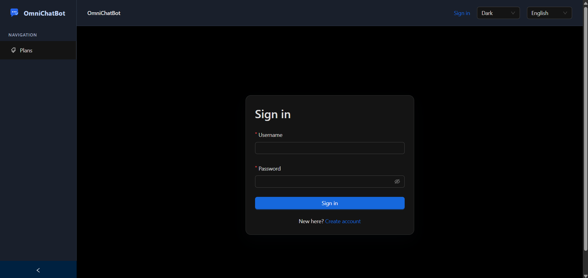
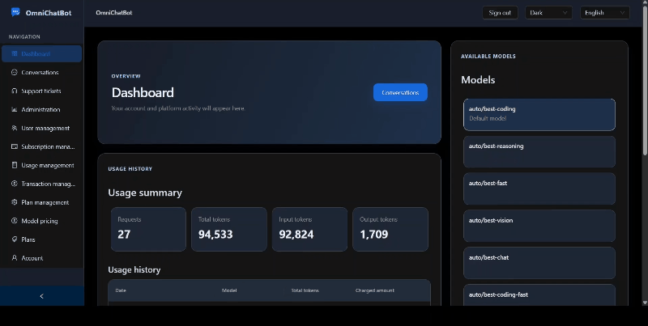
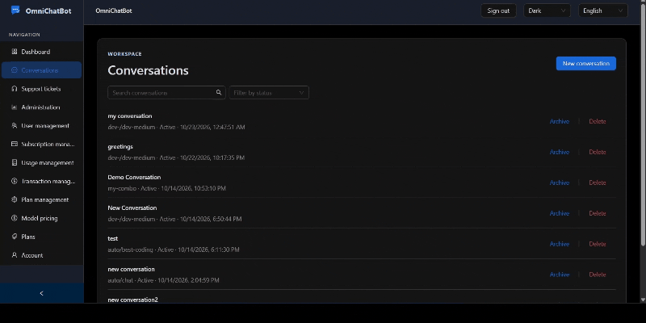
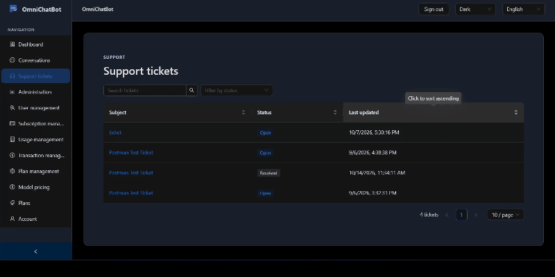
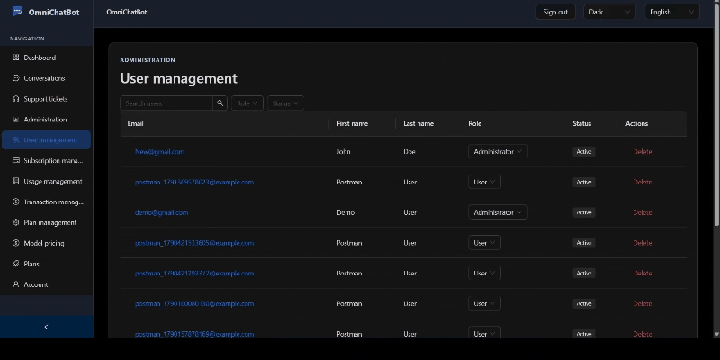
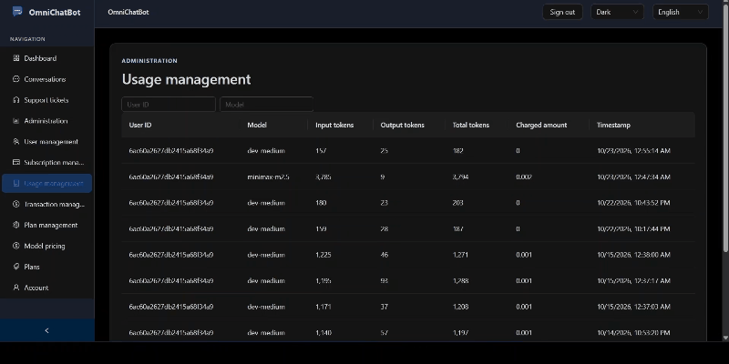
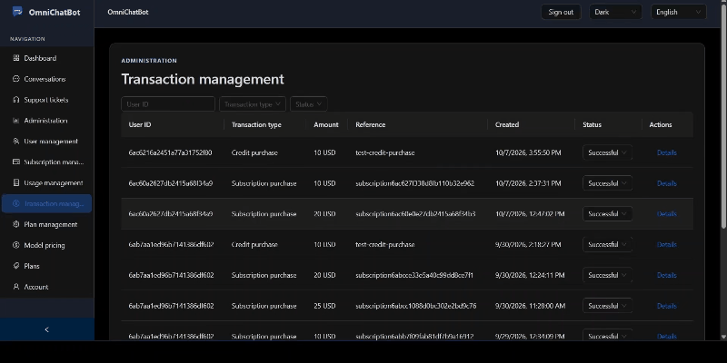
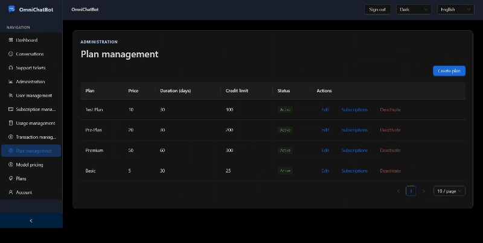
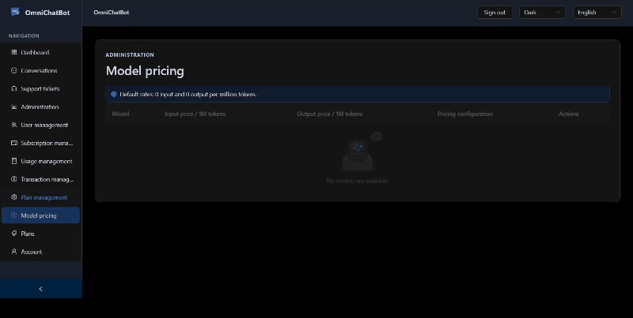

# OmniChatBot

OmniChatBot is a bilingual AI chat and account-management web application. The frontend is built with React, TypeScript, Vite, and Ant Design, and communicates with the OmniChatBot backend over its REST API.

## Screenshots and demos

Screenshots and animated walkthroughs are stored in [`media/`](media/).

### Sign in



### Dashboard



### Conversations



### Support tickets



### Administration

| User management | Usage management |
|---|---|
|  |  |

| Transaction management | Plan management |
|---|---|
|  |  |

### Model pricing



## Features

- Account registration, sign-in, and profile management.
- AI conversations with model selection and message history.
- Usage dashboard with usage summaries and available model catalog.
- Support ticket creation and ticket history.
- Public plan browsing.
- Admin dashboard and management views for users, subscriptions, usage, transactions, plans, and model pricing.
- English and Persian translations, including right-to-left layout support.
- Light and dark themes.

## Requirements

- Node.js and npm.
- A running compatible backend API. By default, the frontend expects it at `http://localhost:8080/api`.

## Getting started

```sh
npm install
npm run dev
```

Vite prints the local development URL after startup.

To use a backend at another URL, create a `.env.local` file in the project root and set:

```dotenv
VITE_API_BASE_URL=http://localhost:8080/api
```

Replace the value with the backend API base URL for your environment. Vite loads this variable at startup, so restart the dev server after changing it. Do not put secrets in `VITE_*` variables: values exposed to the frontend are included in the browser bundle.

## Available scripts

| Command | Purpose |
|---|---|
| `npm run dev` | Start the Vite development server. |
| `npm run lint` | Run ESLint. |
| `npm run build` | Type-check the project and create a production build in `dist/`. |
| `npm run preview` | Serve the production build locally for preview. |

## Tech stack

- React 19 and TypeScript
- Vite
- Ant Design and Ant Design Icons
- React Router
- i18next and react-i18next
- Axios

## Project structure

```text
public/       Static assets, logo, and favicon
media/  Product screenshots and animated walkthroughs
src/api/      Backend API clients and DTOs
src/pages/    Application pages
src/           App shell, styles, translations, and entry point
```

## License

No license is specified in this repository yet.
